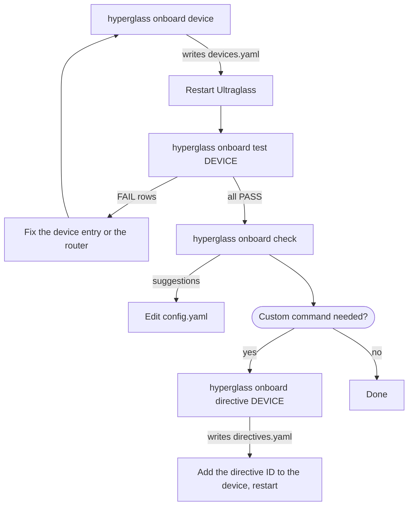

# Device onboarding

Use `hyperglass onboard` to create a device entry, test its commands, and review feature settings. Run it inside the application container or with the same `HYPERGLASS_APP_PATH` and Redis settings as your installation.

```shell
hyperglass onboard device
hyperglass onboard test my-router
hyperglass onboard check
hyperglass onboard directive my-router
```

Each command accepts `--json`. Prompts go to standard error. Standard output contains one JSON report when this flag is set. Without the flag, each command prints a plain-text report and a status summary. Test failures and invalid configuration return exit code `1`. Disabled optional features from `check` do not count as test failures.

## Workflow

Onboard a router in this order. Run `check` at any time; it does not need a device.



1. `device` asks for the router details and saves the entry.
2. Restart Ultraglass so the application loads the entry.
3. `test` sends every built-in command the device offers and reports PASS or FAIL for each one.
4. `check` reports the feature settings in effect and suggests changes.
5. `directive` is optional. It builds and tests a custom command.

## Create or update a device

```shell
hyperglass onboard device
```

Enter a new device name, or an existing device name or ID to update it. The prompts collect the address, SSH port, platform, credential, OS version, VRF, structured-output preference, and required command attributes such as source addresses. The structured-output prompt appears only for platforms with structured support. The attribute prompts follow the built-in directives the device offers, so a VRF device or a platform without source attributes gets fewer prompts. Enter `?` at the platform prompt to list platform keys. Unknown platform keys produce spelling suggestions. The interactive editor supports SSH platforms; configure HTTP devices directly in the devices file.

This example adds an FRRouting router with password authentication:

```text
$ hyperglass onboard device
Device name or existing ID: core1
Address []: 198.51.100.10
Port [22]:
Platform (? lists platforms) []: frr
Username []: lg
SSH private key path (blank for password) []:
Password:
OS version (- to unset) []:
VRF (- to unset) []:
Enable structured output? [y/N]: y
Attribute source4 []: 198.51.100.10
Attribute source6 []: 2001:db8:100::10
Save devices YAML (comments and formatting are rewritten)? [y/N]: y
Saved core1 to /etc/hyperglass/devices.yaml. Restart Ultraglass to load it.
```

The saved entry:

```yaml
- name: core1
  address: 198.51.100.10
  port: 22
  platform: frr
  credential:
    username: lg
    password: example-pass
  structured_output: true
  attrs:
    source4: 198.51.100.10
    source6: 2001:db8:100::10
```

Use a password or an existing private-key file. Passwords and key passphrases stay hidden. Updating a device keeps its existing credential unless you choose to replace it. Press Enter to keep the displayed OS version or VRF. Enter `-` to unset either field.

The command validates the entry with the application's `Device` model. It asks before saving. Unrelated device fields and other device entries remain intact. YAML comments and formatting are rewritten. Existing `main`, `devices`, and `routers` keys are supported. Convert Python, JSON, or TOML devices files to YAML before using the editor.

The command creates new files with owner-only permissions. Existing file permissions remain intact. It rejects a save if another process edits the file during the prompts. Credentials stay in `devices.yaml`; the command does not publish the candidate configuration to Redis or write query/session logs. Restart Ultraglass after saving.

## Test device commands

```shell
hyperglass onboard test my-router \
  --ipv4 1.1.1.1 \
  --ipv6 2606:4700:4700::1111 \
  --route-ipv4 1.1.1.0/24 \
  --route-ipv6 2606:4700::/44 \
  --as-path '13335$' \
  --community 37195:302 \
  --json > onboard-report.json
```

These are the default targets. Choose route, AS path, and community targets that exist in your router's table. Choose a narrow AS path expression when testing large routing tables.

The plain-text report has one block per query, then a summary. This is part of a report for a Cisco IOS router:

```text
$ hyperglass onboard test edge1

edge1 / __hyperglass_cisco_ios_bgp_route_table__ / 1.1.1.0/24
  Planned command: show bgp ipv4 unicast 1.1.1.0/24 | exclude pathid:|Epoch
  Sent: show bgp ipv4 unicast 1.1.1.0/24 | exclude pathid:|Epoch
  Fallback used: False (version: False)
  communities: 10 populated; 3 empty
  rpki_state: 13 populated; 0 empty; 0 unverified
  age: 13 populated; 0 empty
  next_hop: 13 populated; 0 empty

edge1 / __hyperglass_cisco_ios_traceroute__ / 1.1.1.1
  Planned command: traceroute 1.1.1.1 timeout 1 probe 2 source 192.0.2.1
  Sent: traceroute 1.1.1.1 timeout 1 probe 2 source 192.0.2.1
  Fallback used: False (version: False)
  ip_address: 9 populated; 0 empty
  rtt1: 9 populated; 0 empty
  rtt2: 8 populated; 1 empty
  rtt3: 0 populated; 9 empty
  asn: 3 populated; 6 empty
  org: 3 populated; 6 empty

Status	Feature / query	Target
PASS	__hyperglass_cisco_ios_traceroute__	1.1.1.1
PASS	__hyperglass_cisco_ios_traceroute__	2606:4700:4700::1111
PASS	__hyperglass_cisco_ios_bgp_route_table__	1.1.1.0/24
PASS	__hyperglass_cisco_ios_bgp_route_table__	2606:4700::/44
PASS	__hyperglass_cisco_ios_bgp_community_table__	37195:302
PASS	__hyperglass_cisco_ios_ping__	1.1.1.1
PASS	__hyperglass_cisco_ios_ping__	2606:4700:4700::1111
PASS	__hyperglass_cisco_ios_bgp_aspath_table__	13335$
8 passed; 0 failed
```

The command runs each built-in directive the device actually offers. It tests IPv4 and IPv6 rules separately. AS path and community directives can send both address-family commands in one query. VRF devices use their VRF commands. Disabled built-ins and custom directives are excluded.

Each result includes planned commands, commands sent, device command errors, fallback use, and parsed field coverage. Version-selected fallback commands are identified separately from retries after a rejected command. The report includes populated and empty counts for communities, RPKI state, age, and next hop. RPKI state `3` has a separate unverified count. Traceroute reports addresses, RTT fields, ASN, and organisation coverage.

Coverage describes the parsed result after configuration policy and model defaults. A community policy can remove communities. A parser can supply zero for an unavailable age. Async enrichment fields can remain empty because this command reports the immediate parser result. An empty field alone does not fail the command.

A pass means the command returns usable output through the configured driver and parser. It does not mean a ping succeeds or a traceroute reaches its destination. Command rejection, connection failure, parser failure, no output, and empty structured tables produce failed results. Later queries still run. A device with no built-in directives returns an error. Connection and command timeouts follow `request_timeout` in `config.yaml`.

Successful built-in reports omit full router output to keep large route tables out of the report. Failed command output remains available. Test reports contain router commands and network data; inspect them before attaching them to a public issue.

## Check feature settings

```shell
hyperglass onboard check --json
```

The check reads configuration files afresh. It reports effective settings, including defaults, for structured BGP and traceroute, external RPKI, the selected RPKI backend, Redis cache reachability, IP enrichment, server DNS, and My IP. Device checks cover structured-capable platforms left in text mode and missing OS versions where offered commands have version filters.

Each setting shows its current value. A `Set:` line follows when a change is suggested. The summary marks each row PASS, OFF or UNKNOWN:

```text
$ hyperglass onboard check
Structured bgp_route: True
Structured traceroute: True
External RPKI: router
  Set: structured.rpki.mode: external
RPKI backend: cloudflare
RPKI cache: unreachable
  Set: Set HYPERGLASS_REDIS_DSN to a reachable Redis database
enrich_traceroute: False
  Set: structured.ip_enrichment.enrich_traceroute: true
enrich_bgproute: False
  Set: structured.ip_enrichment.enrich_bgproute: true
Server DNS: cloudflare
  Set: web.dns_provider.name: server
My IP: server
Self-hosted fonts: No built UI found; run hyperglass build-ui
  Set: No built UI found; run hyperglass build-ui
edge1: structured output: False
  Set: devices[edge1].structured_output: true
edge1: OS version: None
  Set: devices[edge1].os_version: '<installed version>'
core1: structured output: True

Status	Feature / query	Target
PASS	Structured bgp_route
PASS	Structured traceroute
OFF	External RPKI
PASS	RPKI backend
OFF	RPKI cache
OFF	enrich_traceroute
OFF	enrich_bgproute
OFF	Server DNS
PASS	My IP
UNKNOWN	Self-hosted fonts
OFF	edge1: structured output
OFF	edge1: OS version
PASS	core1: structured output
```

Self-hosted font detection examines the served UI under `static/ui`. A missing build is reported as unknown. A build that links Google Fonts is reported as off. Rebuild with `hyperglass build-ui` and working font-download access to self-host the fonts.

Suggestions use dotted setting paths, such as `structured.rpki.mode: external`. Apply them as nested YAML in the relevant file. The command does not edit `config.yaml`. The global `structured.enable_for_bgp_route` and `structured.enable_for_traceroute` toggles default to enabled, so an omitted `structured` block is not reported as disabled. Each device still requires `structured_output: true` to opt in. The device prompt defaults to no unless the existing entry enables structured output. Router-supplied RPKI remains valid when external RPKI is off. Redis reachability does not verify the external validator's health.

## Scaffold a custom directive

```shell
hyperglass onboard directive my-router
```

Enter a new directive ID, a command template for the selected device's platform, an IP-prefix or regular-expression target rule, and a test target. The ID must start with a letter and contain only letters, digits, hyphens or underscores. It must not match part of an existing directive ID. Use `{target}` in the command template. On a VRF device, a template that contains `{vrf}` is also saved as the rule's `vrf_command`. The command rejects a template that references an attribute the device does not define. It validates the directive, runs it once, and shows its output. A successful test offers to save it in `directives.yaml`. Add the reported directive ID to the device's `directives` list and restart Ultraglass to expose it in the application.

The prompts for a directive that shows one prefix from the FRRouting RIB:

```text
$ hyperglass onboard directive core1
New directive ID: rib-prefix
Command template for frr (use {target}): vtysh -c "show ip route {target}"
Target rule (IP prefix or regular expression) [0.0.0.0/0]:
Test target: 1.1.1.0/24
```

The command then prints the test result in the same format as `onboard test`. After you confirm the save, `directives.yaml` contains:

```yaml
rib-prefix:
  name: rib-prefix
  field:
    description: Target
  rules:
    - condition: 0.0.0.0/0
      command: vtysh -c "show ip route {target}"
```
